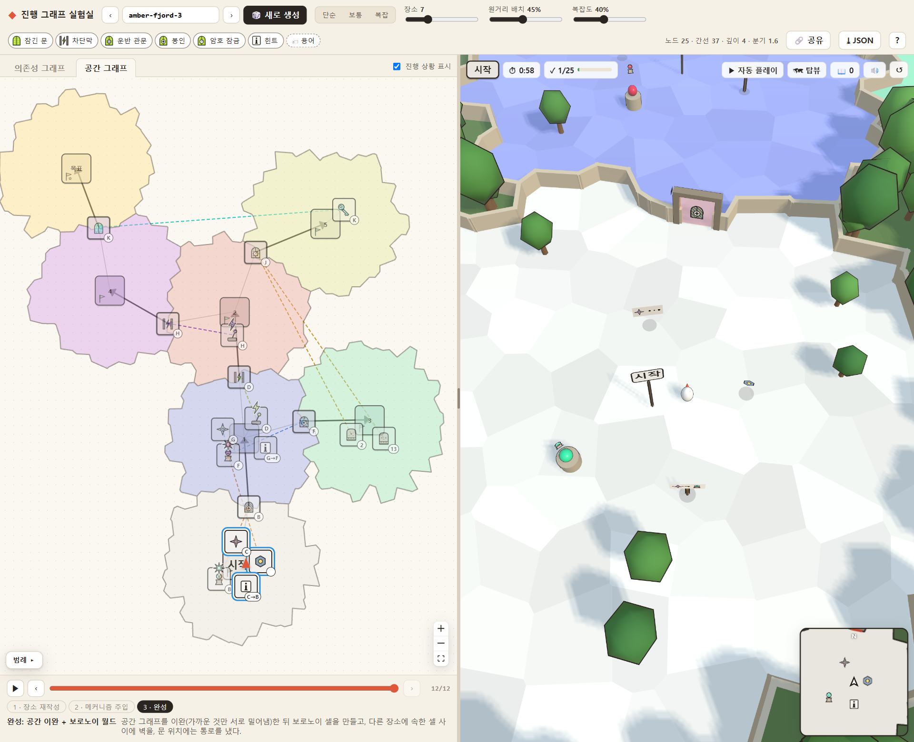
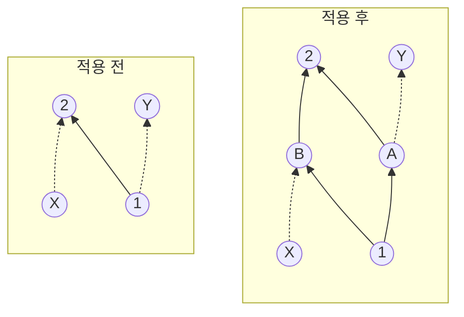
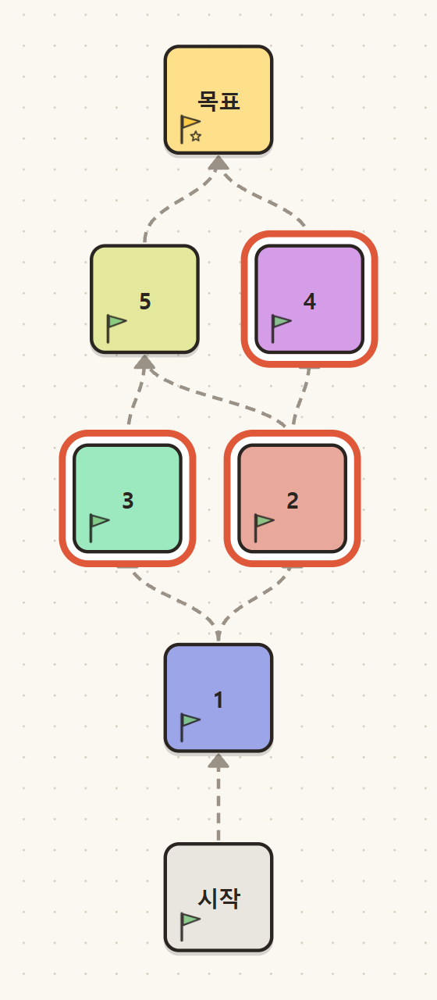
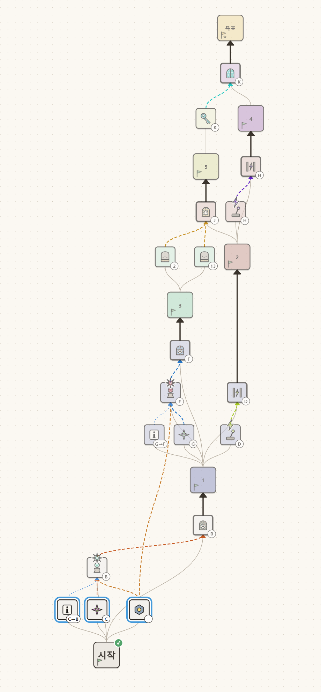
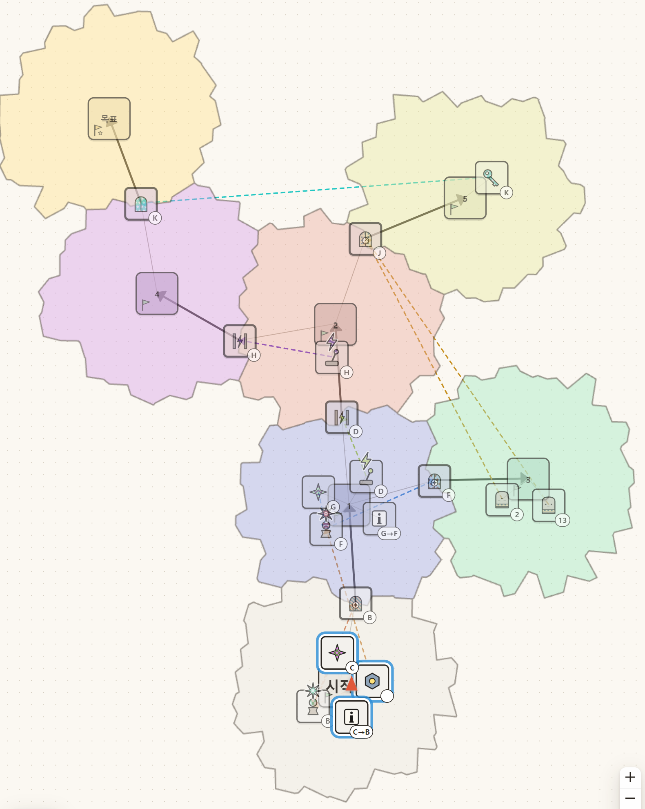

# 진행 그래프 실험실

시드 하나로 레벨의 진행 구조(의존성 그래프)와 지도(공간 그래프)를 함께 생성하고, 결과를 3D로 바로 걸어 다니며 플레이해 볼 수 있는 도구입니다.

Rune Skovbo Johansen의 글 [Procedural game progression dependency graphs](https://blog.runevision.com/2024/10/procedural-game-progression-dependency.html)에서 제안한 방식을 그대로 구현했습니다.



## 의존성 그래프

"무엇을 하려면 무엇이 먼저 필요한가"를 나타내는 그래프입니다. 아래쪽이 시작, 위쪽이 목표이고 화살표는 선행 조건에서 결과 쪽으로 향합니다.

생성은 두 단계로 나뉩니다.

### 1. 장소 재작성

`시작 → 목표` 한 줄에서 출발해 아래 규칙을 반복 적용합니다. 간선 하나를 골라 그 사이에 장소 두 개를 병렬로 끼워 넣고, 기존의 다른 부모·자식을 새 장소 쪽으로 옮겨 답니다. 각 장소의 진입·진출 차수는 1~2로 유지되기 때문에 갈림길은 생기지만 거미줄처럼 엉키지는 않습니다.





이 단계가 끝나면 장소 사이의 순서만 정해진 상태가 됩니다. 어떤 장소에 어떻게 들어가는지는 아직 정해지지 않았습니다.

### 2. 메커니즘 주입

장소를 위상 순서대로 돌면서 각 장소의 입구에 관문을 하나씩 세우고, 그 관문을 여는 데 필요한 물건(열쇠, 스위치, 단서 등)을 **이미 갈 수 있는 장소**에 숨깁니다. 숨기는 곳은 부모 장소이거나 그보다 더 앞의 조상 장소입니다. 그래서 물건을 추가해도 1단계에서 정한 장소 간 의존성은 바뀌지 않습니다.

- **원거리 배치**: 물건을 바로 앞 장소 대신 더 먼 조상 장소에 둘 확률입니다. 높일수록 왔던 길을 되돌아가는 동선이 늘어납니다.
- **복잡도**: 0이면 갈림길이 없는 일직선이 되고 관문마다 물건이 하나씩 붙습니다. 높일수록 병렬 갈림길과 물건 여러 개가 필요한 관문이 늘어납니다.



| 표시 | 의미 |
|---|---|
| 큰 사각형 | 장소 (색은 지역 구분) |
| 작은 사각형 | 관문 또는 물건 |
| 굵은 검은 화살표 | 관문이 장소를 열어 줌 |
| 색 점선 화살표 | 반드시 필요한 선행 조건 |
| 가는 점선 | 정보. 없어도 시행착오로 풀 수 있음 |
| 회색 곡선 | 물건이 그 장소 안에 있음 |
| 같은 색·무늬 | 서로 짝 (열쇠 ↔ 잠긴 문) |

하단 타임라인으로 생성 과정을 한 단계씩 되돌려 볼 수 있습니다.

## 공간 그래프

의존성 그래프와 **같은 노드**를 이번에는 실제 위치에 배치한 그래프입니다. 의존성 그래프는 순서를, 공간 그래프는 위치를 보여 줍니다. 공간 그래프는 완성된 의존성 그래프를 입력으로 받아 별도의 공간 시드로 만들기 때문에, 의존성 그래프를 그대로 둔 채 배치만 다시 뽑을 수 있습니다.

1. 장소를 위상 순서대로 놓습니다. 새 장소는 자신의 입구가 붙은 장소 옆에 생기고, 물건은 그것이 숨겨진 장소 안에 놓입니다.
2. 짧은 거리에서만 작동하는 반발력으로 배치를 이완합니다. 멀리 떨어진 노드끼리는 서로 밀어내지 않아서 지도가 퍼지지 않고 오밀조밀하게 굽습니다.
3. 배치된 점들로 보로노이 셀을 만듭니다. 서로 다른 장소에 속한 셀 사이에는 벽을 세우고, 관문 위치에는 통로를 냅니다.



장소를 가로지르는 색 점선은 물건과 그것이 여는 관문을 잇습니다. 선이 길수록 플레이어가 멀리 오가야 한다는 뜻입니다.

## 편집과 재생성

두 그래프 모두 직접 고칠 수 있습니다. 편집은 타임라인의 마지막 단계에서 합니다.

- **의존성 그래프**: 노드를 클릭하면 오른쪽 패널에 편집 항목이 나옵니다. 장소는 뒤에 추가·갈래 추가·다음 장소 연결·삭제가 되고, 관문은 종류와 필요한 물건 수를 바꿀 수 있습니다. 물건은 놓을 장소를 고를 수 있는데, 의존성을 깨뜨리지 않는 장소만 목록에 나옵니다. 어떻게 고치든 항상 풀 수 있는 그래프로 정리됩니다.
- **공간 그래프**: 노드를 끌어서 옮기면 그 자리에 📌 고정되고, 나머지 노드는 그 주변으로 다시 이완됩니다. 장소를 옮기면 그 안의 물건도 함께 움직입니다.

재생성은 세 가지입니다.

| 버튼 | 단축키 | 동작 |
|---|---|---|
| 새로 생성 | `N` | 두 그래프를 모두 새 시드로 생성 |
| 의존성만 | `D` | 의존성 그래프만 새로 생성하고 공간 시드는 유지 |
| 공간만 | `S` | 지금 의존성 그래프(직접 만든 것 포함)는 그대로 두고 배치만 새로 생성 |

그래서 **빈 그래프에서 시작**으로 의존성 그래프를 손으로 만든 뒤, **공간만**을 눌러 마음에 드는 배치가 나올 때까지 뽑아 보는 식으로 쓸 수 있습니다. 상단의 **장소** 버튼(2·3·4·6·8·12, 옆 칸에 2~20 직접 입력)은 생성할 장소 개수입니다. 편집은 `Ctrl+Z`로 되돌릴 수 있고, 편집 내용과 고정 위치는 공유 링크에 함께 담깁니다.

## 메커니즘

규칙은 장르와 무관하게 추상화해 두었습니다. 화면에 보이는 이름은 상단 **용어** 버튼에서 바꿀 수 있고, 판타지·SF·방탈출 프리셋도 들어 있습니다.

| 메커니즘 | 규칙 |
|---|---|
| 열쇠 잠금 | 열쇠 하나가 잠긴 문 하나를 엽니다 |
| 원격 스위치 | 흩어진 스위치를 모두 작동시키면 멀리 있는 차단막이 열립니다 |
| 동행체 운반 | 유인 아이템을 가지고 다가가면 동행체가 따라옵니다. 관문까지 데려가면 열립니다 |
| 능력 사용 | 도구를 가진 채 습득한 능력을 발동대에서 쓰면 멀리 있는 봉인이 열립니다 |
| 정보 잠금 | 흩어진 단서를 모아 세 자리 암호를 알아냅니다 |

## 실행

```bash
pnpm install
pnpm dev        # http://localhost:5173
pnpm build
```

플레이 조작: `WASD` 이동, 마우스로 시점 조작, `E` 상호작용, `P` 자동 플레이입니다.

자동 플레이 봇으로 생성된 레벨, 그리고 무작위 편집을 거친 레벨을 실제로 끝까지 깰 수 있는지 일괄 검증합니다.

```bash
pnpm dlx tsx scripts/bot.ts
pnpm dlx tsx scripts/edit.ts
```

## 구조

```
src/core/    생성기: 장소 재작성(locations), 의존성 명세와 주입(spec), 편집 연산(edit), 배치·이완(spatial), 보로노이 월드(world)
src/graph/   xyflow 기반 의존성·공간 그래프 뷰
src/game/    게임 규칙(runtime), PixiJS 3D 씬, 자동 플레이 봇
src/play/    플레이 패널, 미니맵, 대화상자
src/ui/      상단 바, 타임라인, 용어 편집기 등
src/terms.ts 사용자 정의 용어와 조사 처리
```
